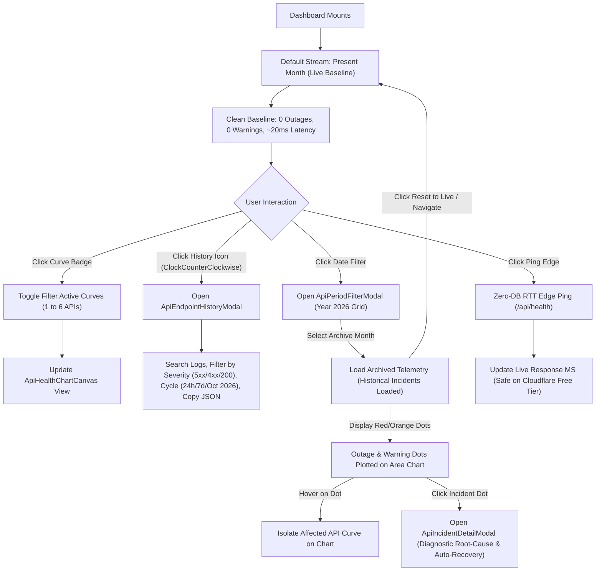
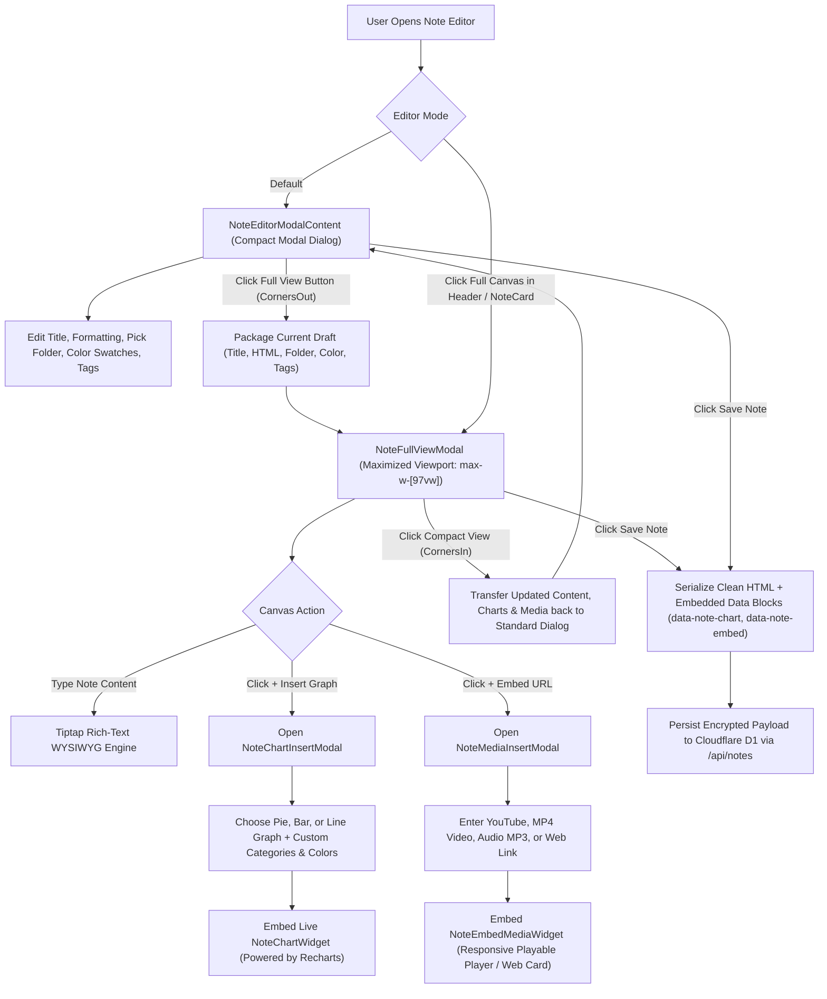
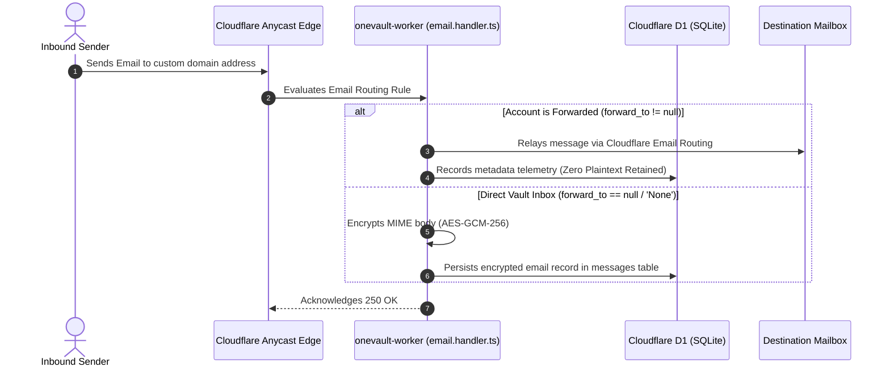
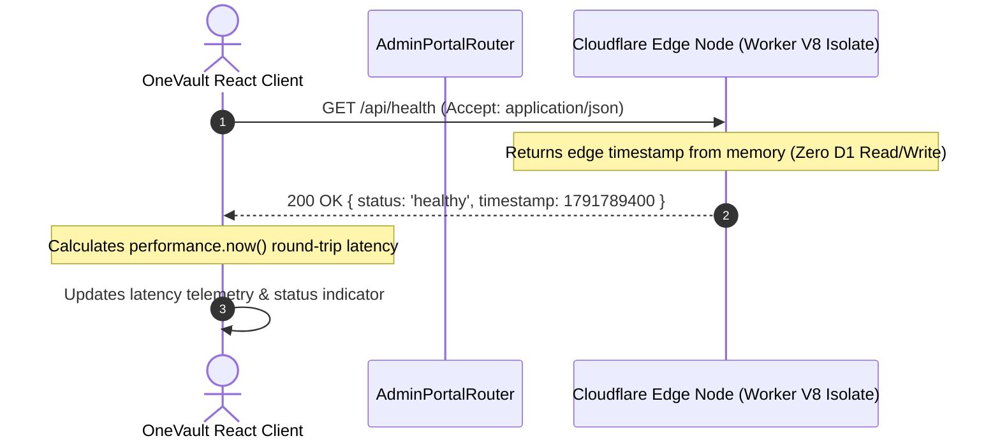
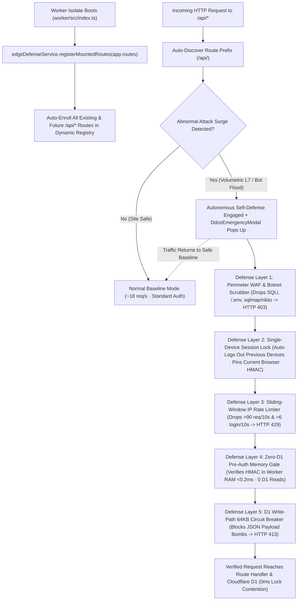
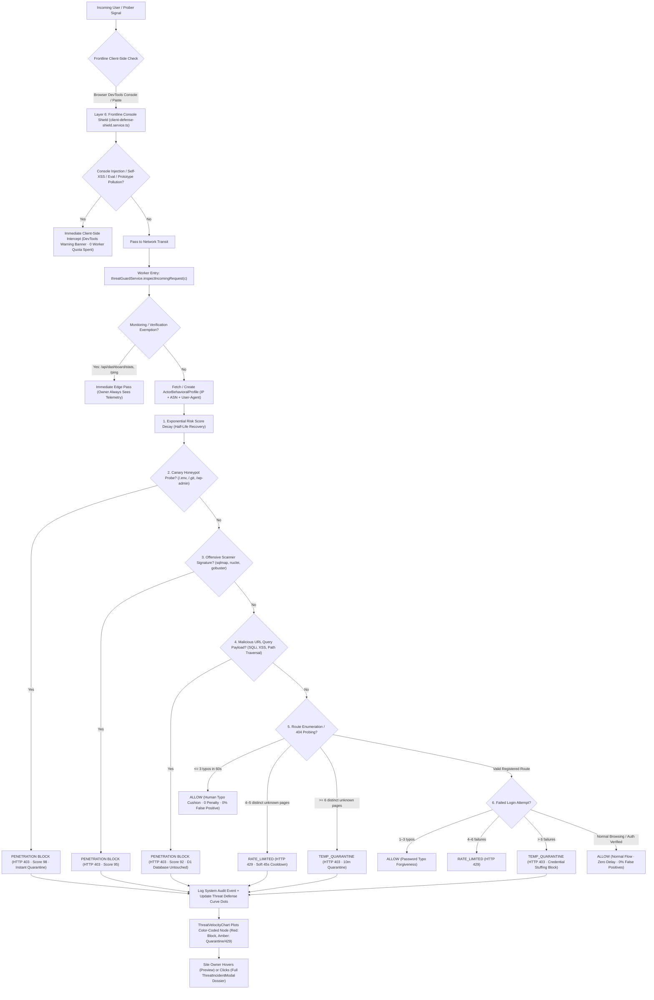
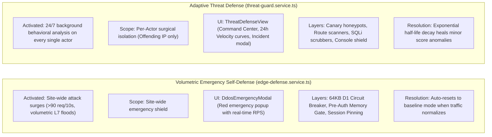
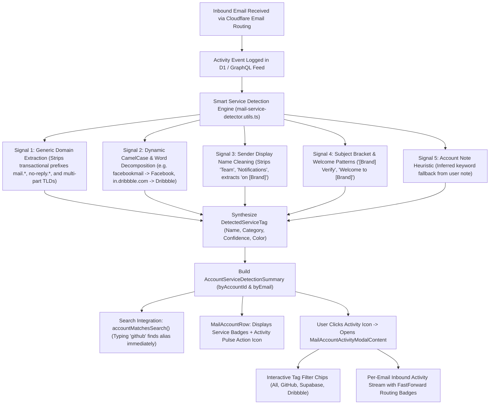

# OneVault — Visual System & Telemetry Flows

This document contains Mermaid diagrams illustrating OneVault's core runtime data flows, user action cycles, and component interaction models.

---

## 1. Live API Health & Telemetry Filter Flow
Tracking real-time response curves across 6 core Cloudflare Worker endpoints, with monthly fresh baselines, archive auditing, incident diagnostic modals, and endpoint history logs.



---

## 2. Note Taking & Full-View Canvas Flow
Seamlessly switching between compact editing and high-productivity full-screen canvas with interactive Recharts graphs and playable media embeds.



---

## 3. Email Routing & D1 Storage Flow
How OneVault routes incoming email messages through Cloudflare Email Routing and stores zero-knowledge payloads in SQLite D1.



---

## 4. Zero-DB Edge Latency Ping Flow
How OneVault tests Cloudflare Edge latency without incurring D1 write operations or exceeding free-tier resource limits.



---

## 5. Autonomous 5-Layer Edge Self-Defense & Zero-Hardcode API Enrollment Flow
How OneVault automatically discovers every mounted or runtime `/api/*` endpoint without hardcoding, activates its 5-Layer Self-Defense pipeline during volumetric L7 or D1 exhaustion attacks, and automatically returns to normal baseline mode when safe.



---

## 6. Threat Defense Behavioral Evaluation & Isolation Pipeline
How OneVault evaluates every request signal across 6 antibody layers, maintains a 0.00% false-positive rate with exponential decay and typo forgiveness, and isolates attackers without locking down the site.



---

## 7. Emergency DDoS Defense vs. Surgical Threat Defense Comparison



---

## 8. Smart Inbound Email Service Detection & Purpose Tagging Pipeline
How OneVault automatically extracts service identities and platforms from incoming email activity, generates searchable purpose tags, renders per-email activity feeds, and signals forwarded routing with distinct iconography.



---

## 9. Local-First Debounced Batch Sync & Write Cycle
How OneVault guarantees zero write lag (perceived 0ms response) while batching mutations and minimizing writes to preserve Cloudflare D1 free-tier quotas.

```mermaid
flowchart TD
    UserEdit["User Performs Write Action (Notes, Mail Note, Forwarding Destination, Filter Preferences)"] --> Service["Domain Service Method (e.g. mailService.update, notesService.updateNote)"]

    %% Local-First Optimistic Stage
    Service --> Optimistic["Stage 1: Optimistic Local State (0ms Perceived Latency)"]
    Optimistic --> ReactState["Update React In-Memory State (Instant UI Re-render)"]
    Optimistic --> LocalCache["Update Domain localStorage Cache (e.g. onevault.mail.cache.v1)"]
    Optimistic --> Enqueue["Enqueue to syncQueueService (Persisted in localStorage: onevault_pending_sync_queue)"]

    %% Queue Merging & Deduplication
    Enqueue --> Dedupe{"Does mutation key already exist in queue?"}
    Dedupe -->|"Yes (e.g. rapid typing in note)"| Merge["Merge / Overwrite Payload by syncKey (Keeps Latest State)"]
    Dedupe -->|"No"| NewEntry["Add New Mutation Entry to Queue"]

    Merge & NewEntry --> ResetTimer["Reset Idle Debounce Timer (2500ms Window)"]

    %% Flush Triggers
    ResetTimer --> TriggerCheck{"Flush Trigger Occurs"}
    TriggerCheck -->|"User goes idle for 2.5s"| Flush["Execute syncQueueService.flush()"]
    TriggerCheck -->|"visibilitychange (User switches tab/minimizes)"| Flush
    TriggerCheck -->|"beforeunload (User closes browser/window)"| Flush
    TriggerCheck -->|"online (Network connection restored)"| Flush

    %% Network Execution
    Flush --> WorkerAPI["Call Cloudflare Worker API via direct fetch (apiClient / apiRequest)"]
    WorkerAPI --> Endpoints["PATCH /api/mail/:id | POST /api/mail/preferences | PATCH /api/notes/:id"]
    Endpoints --> D1["Consolidated Cloudflare D1 Database Write Transaction"]

    %% Resolution & Cleanup
    D1 --> Success{"Write Succeeded?"}
    Success -->|"Yes"| RemoveQueue["Remove Mutation from Queue & Update localStorage"]
    RemoveQueue --> SyncedState["Set Status: 'synced' -> 'idle'"]
    Success -->|"Network Error"| Retry["Increment retryCount (Retries automatically on next idle or 'online' event)"]

---

## 10. Universal Project Gateway Connection, Protection & Activity Telemetry Flow
How connected sites (e.g. GIGAMAXX 4K) pair with OneVault via Gateway Token, undergo edge scrubbing, conceal upstream APIs, and stream live audit events into Cloudflare D1.

```mermaid
sequenceDiagram
    autonumber
    actor Dev as Developer / Site Owner
    participant ClientApp as Connected App (e.g. GIGAMAXX)
    participant Modal as OneVault ProjectIntegrationModal
    participant Edge as OneVault Worker (/api/gateway)
    participant D1 as Cloudflare D1 Database
    participant Activity as RecentActivityFeed (OneVault)

    %% Step 1: Project Provisioning
    Dev->>Modal: Creates Project or opens Connection Modal
    Modal->>Dev: Generates Gateway Token (ov_live_*) & Universal .env Snippet
    Note over Dev,ClientApp: Developer pastes ONEVAULT_GATEWAY_URL & TOKEN into .env

    %% Step 2: Boot Handshake
    ClientApp->>Edge: POST /api/gateway/:slug/handshake (X-OneVault-Token)
    Edge->>D1: Verify token & UPDATE connected_projects SET status='active', last_seen_at=NOW()
    Edge->>D1: INSERT INTO system_audit_logs ([Project] Handshake Verified)
    Edge-->>ClientApp: 200 OK (status: 'active', verified: true)
    
    %% Step 3: Live Pairing Detection
    Modal->>Edge: Polls GET /api/projects/:id/verify
    Edge-->>Modal: Status changed: 'connecting' (Amber) -> 'active' (Emerald Green)
    Modal-->>Dev: Verified badge turns Green

    %% Step 4: Concealed Streaming & API Calls
    ClientApp->>Edge: GET /api/gateway/:slug/proxy/api/* (Concealed Upstream Query)
    Edge->>Edge: Bot scrub, origin check, DevMode check
    Edge->>ClientApp: Return sanitized upstream data (Upstream host hidden from DevTools)

    %% Step 5: Unified Audit Feed
    Activity->>D1: Fetch recent system_audit_logs
    Activity-->>Dev: Displays [Project] VERIFIED, [Project] STREAM, BLOCKED 403 badges
```
```
